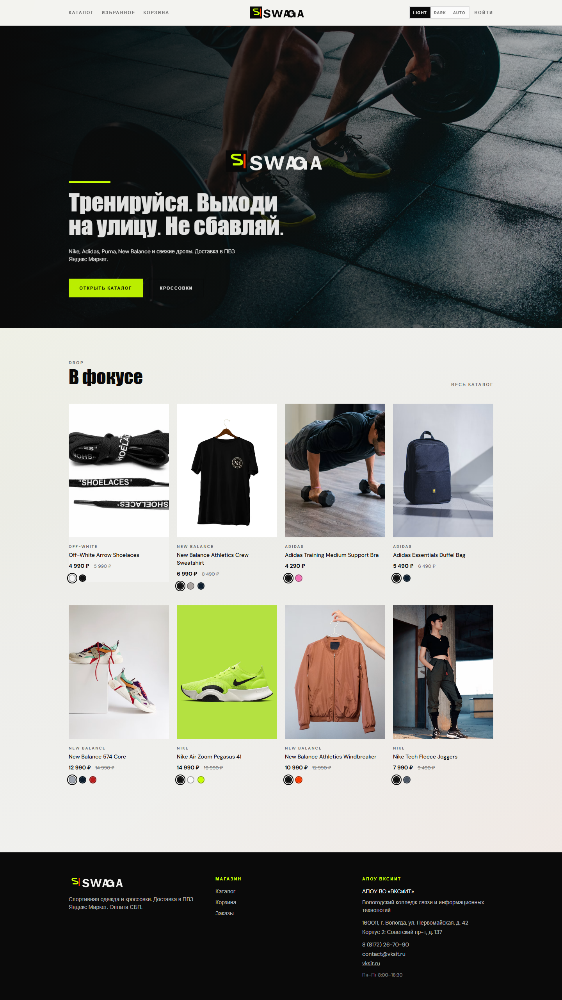
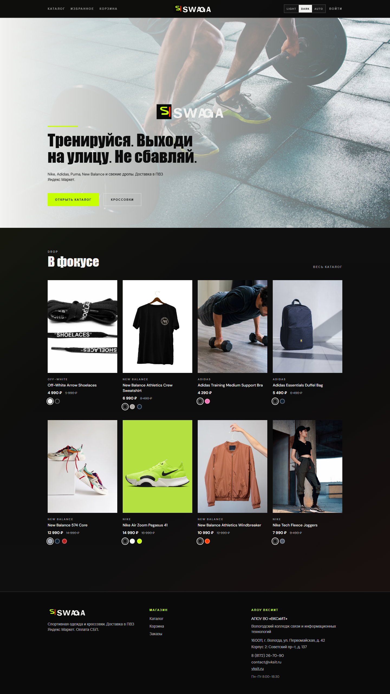
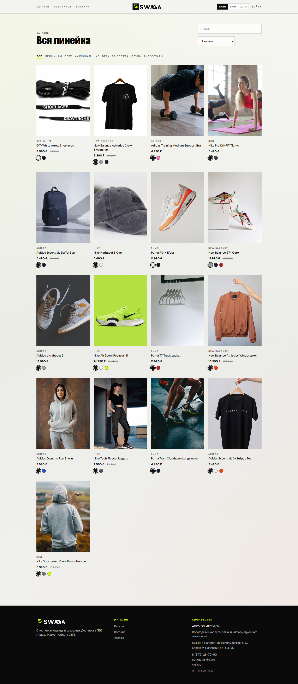
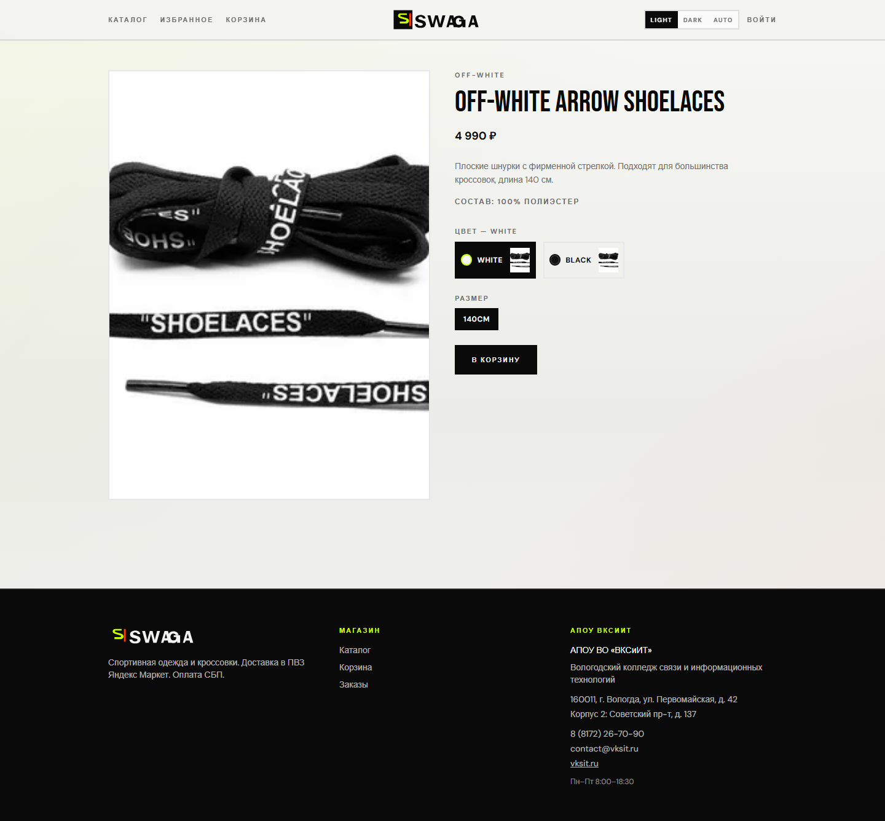
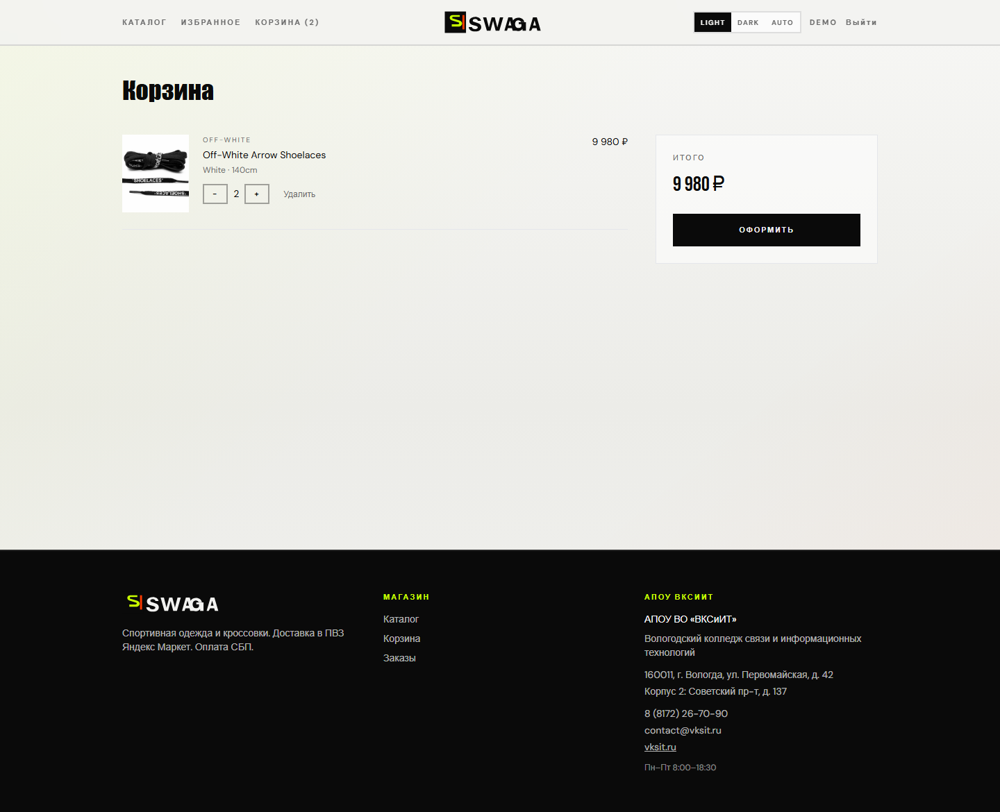
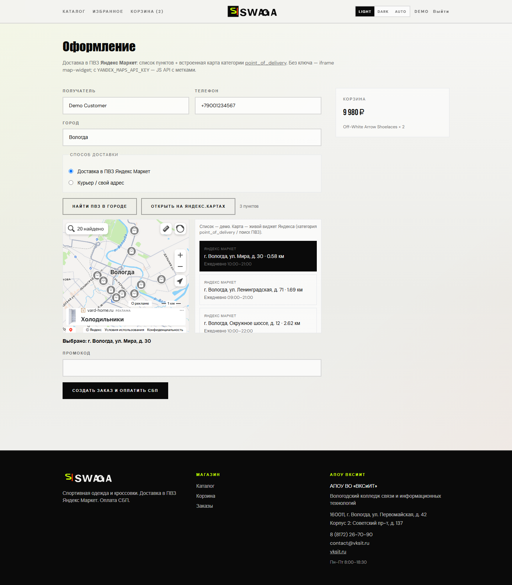
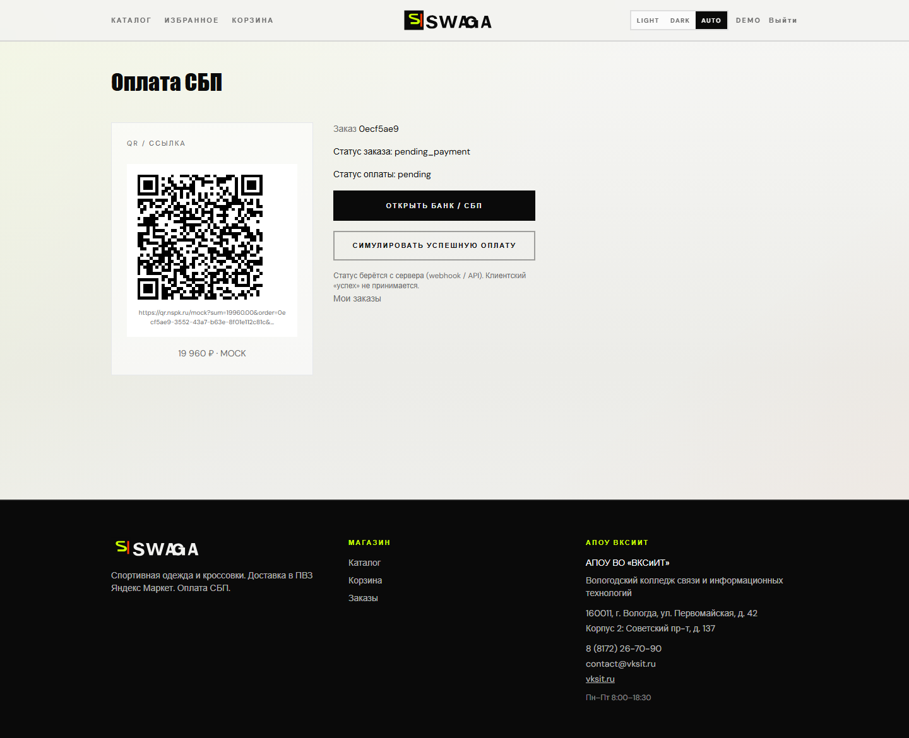
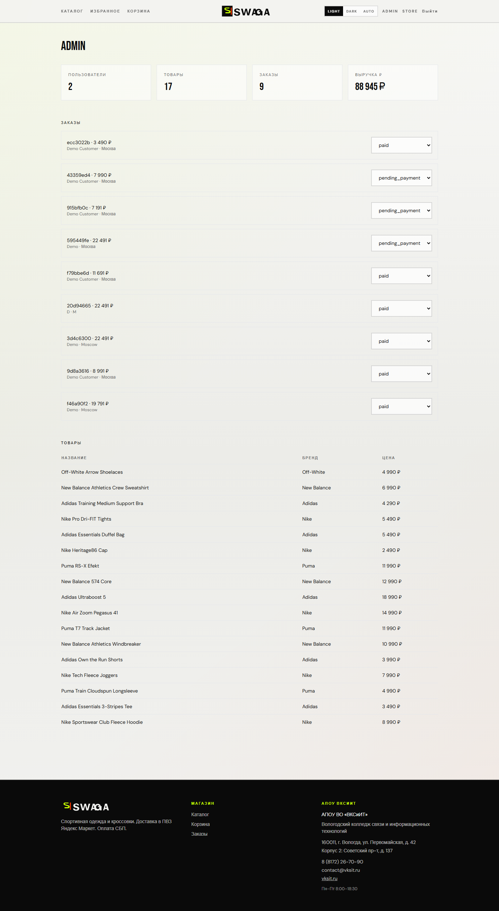
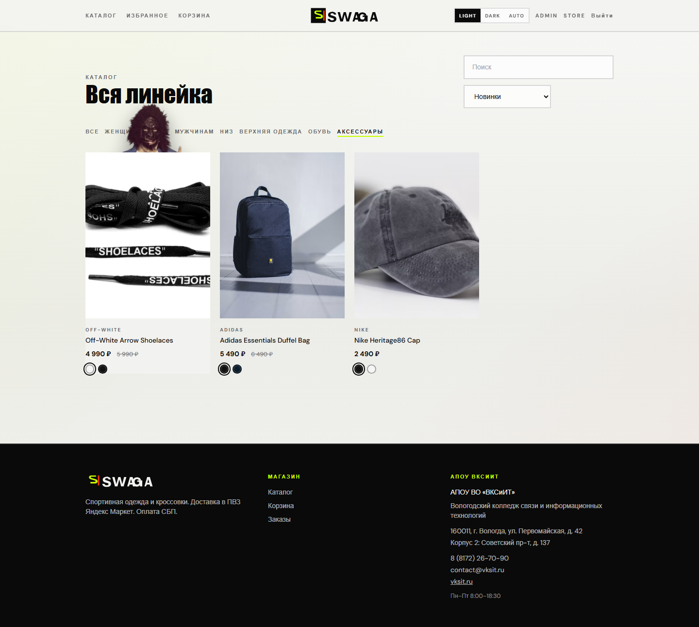
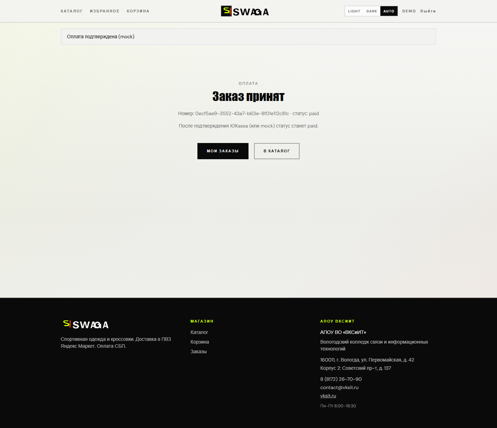

# ПОЯСНИТЕЛЬНАЯ ЗАПИСКА
## к курсовой работе

**Тема:** Разработка интернет-магазина спортивной одежды и обуви «Swaga» с интеграцией оплаты через СБП и доставки в пункты выдачи Яндекс Маркет

---

### ТИТУЛЬНЫЙ ЛИСТ

**Министерство образования Вологодской области**  
**Автономное профессиональное образовательное учреждение**  
**Вологодской области**  
**«Вологодский колледж связи и информационных технологий»**  
**(АПОУ ВО «ВКСИИТ»)**

Специальность: информационные системы и программирование  
(или родственная специальность по учебному плану колледжа)

**КУРСОВАЯ РАБОТА**  
по дисциплине «Разработка веб-приложений» / «Проектирование информационных систем»

**Тема:** Разработка интернет-магазина спортивной одежды и обуви «Swaga» с интеграцией оплаты через СБП и доставки в пункты выдачи Яндекс Маркет

**Выполнил:** студент  
Батманов Даниил Ильич  

**Руководитель:** ___________________________  

г. Вологда, 2026

---

## ОГЛАВЛЕНИЕ

Введение …………………………………………………………………………… 3  
1 Теоретические основы разработки интернет-магазина ……………………… 5  
1.1 Понятие электронной коммерции и модели B2C …………………………… 5  
1.2 Архитектура веб-приложений и выбор технологического стека …………… 6  
1.3 Платёжные системы и Система быстрых платежей (СБП) ………………… 8  
1.4 Логистика самовывоза: пункты выдачи заказов и картографические API … 9  
1.5 Требования к интерфейсу, доступности и персонализации витрины ……… 10  
2 Практическая часть. Разработка интернет-магазина «Swaga» ……………… 12  
2.1 Постановка задачи и анализ требований …………………………………… 12  
2.2 Ход разработки и принятые проектные решения …………………………… 13  
2.3 Архитектура и структура программного решения ………………………… 15  
2.4 Реализация каталога, корзины и личного кабинета ………………………… 17  
2.5 Оформление заказа, ПВЗ Яндекс Маркет и оплата СБП (mock) …………… 18  
2.6 Темы оформления и пасхальный элемент …………………………………… 20  
2.7 Административная панель …………………………………………………… 21  
2.8 Тестирование программного продукта ……………………………………… 22  
Заключение ………………………………………………………………………… 27  
Список использованных источников …………………………………………… 28  
Приложение А. Скриншоты пользовательского интерфейса …………………… 30  
Приложение Б. Инструкция по запуску ………………………………………… 35  

---

## ВВЕДЕНИЕ

Современная розничная торговля всё активнее переходит в цифровую среду. Интернет-магазины обеспечивают круглосуточный доступ к ассортименту, автоматизируют оформление заказа, оплату и выбор способа доставки. Для учебных заведений среднего профессионального образования разработка полноценного веб-магазина позволяет закрепить навыки проектирования информационных систем, серверной логики, работы с базами данных и интеграции внешних сервисов.

Актуальность темы обусловлена необходимостью освоения типовых сценариев электронной коммерции: каталог и карточка товара, корзина, оформление заказа, приём оплаты, выбор пункта выдачи, администрирование заказов. Дополнительную практическую ценность представляют интеграция с национальной Системой быстрых платежей (СБП) через платёжного провайдера и работа с картографическим представлением пунктов выдачи заказов (ПВЗ).

Объект исследования — процесс проектирования и реализации веб-приложения интернет-магазина спортивной одежды и обуви.

Предмет исследования — программные средства и методы построения серверного веб-приложения на языке Python (фреймворк Flask) с шаблонизатором Jinja2, реляционным хранилищем SQLite и имитацией платёжного контура ЮKassa/СБП.

Цель работы — разработать функционирующий интернет-магазин «Swaga» с витриной, корзиной, оформлением заказа, выбором ПВЗ Яндекс Маркет, mock-оплатой СБП, переключателем тем и административной панелью.

Для достижения цели решались следующие задачи:

1. Изучить теоретические основы электронной коммерции, веб-архитектуры, платёжных и логистических интеграций.  
2. Сформулировать функциональные и нефункциональные требования к системе.  
3. Обосновать выбор технологического стека (Flask/Jinja против SPA на Next.js).  
4. Спроектировать структуру данных и модульную архитектуру приложения.  
5. Реализовать пользовательские и административные сценарии.  
6. Интегрировать доставку в ПВЗ Яндекс Маркет (список + карта) и mock-оплату СБП.  
7. Провести тестирование по чек-листу и таблице тест-кейсов.

Практическая значимость работы заключается в получении законченного учебного продукта, пригодного для демонстрации на защите курсовой работы и дальнейшего расширения (реальная ЮKassa, PostgreSQL, продакшен-хостинг).

Структура пояснительной записки включает введение, две главы (теоретическую и практическую), заключение, список источников и приложения со скриншотами интерфейса.

---

## 1 ТЕОРЕТИЧЕСКИЕ ОСНОВЫ РАЗРАБОТКИ ИНТЕРНЕТ-МАГАЗИНА

### 1.1 Понятие электронной коммерции и модели B2C

Электронная коммерция (e-commerce) — это совокупность процессов купли-продажи товаров и услуг с использованием информационно-телекоммуникационных сетей, прежде всего сети Интернет. В модели B2C (Business-to-Consumer) продавец предоставляет витрину физическим лицам: каталог, поиск, карточку товара, корзину, оформление заказа и оплату.

Типовой жизненный цикл заказа в B2C-магазине включает:

- просмотр ассортимента и фильтрацию;  
- добавление вариаций товара (размер, цвет) в корзину;  
- аутентификацию покупателя;  
- указание контактных данных и способа доставки;  
- создание платежа и ожидание подтверждения;  
- передачу заказа на сборку и доставку / самовывоз из ПВЗ;  
- обновление статуса заказа в личном кабинете и у администратора.

Информационная система магазина должна обеспечивать целостность остатков, корректный пересчёт сумм, защиту персональных данных и устойчивость к ошибочным действиям пользователя.

### 1.2 Архитектура веб-приложений и выбор технологического стека

По способу формирования интерфейса выделяют:

1. **Серверный рендеринг (SSR / MPA)** — HTML формируется на сервере (Flask + Jinja2, Django Templates и т.п.). Преимущества: простота деплоя одного процесса, хорошая индексируемость, меньший порог входа для учебных проектов.  
2. **Одностраничные приложения (SPA)** — фронтенд на React/Next.js общается с API. Преимущества: богатый клиентский UX; недостатки — два контура сборки, больше инфраструктуры.

Для курсового проекта «Swaga» выбран подход **Flask + Jinja2 + SQLAlchemy + SQLite**: один Python-процесс обслуживает и HTML-витрину, и REST API (`/api/*`). Такой выбор сокращает время запуска на учебной машине (скрипт `start.bat`), упрощает отладку и соответствует программе СПО по веб-разработке на Python.

Альтернатива на Next.js рассматривалась на этапе анализа: она даёт современный DX и компонентную модель, но требует Node.js, отдельной сборки и сложнее демонстрируется как «один клик — сайт открыт». Для объёма курсовой работы серверный рендеринг на Flask признан достаточным и более прозрачным.

Ключевые библиотеки серверной части:

- Flask — маршрутизация HTTP, сессии, шаблоны;  
- Flask-SQLAlchemy / SQLAlchemy — ORM и модели сущностей;  
- Flask-JWT-Extended — токены для API-аутентификации;  
- Flask-Limiter — ограничение частоты запросов;  
- yookassa — SDK провайдера платежей (при наличии ключей; иначе mock).

### 1.3 Платёжные системы и Система быстрых платежей (СБП)

Система быстрых платежей Банка России позволяет переводить средства по QR-коду или ссылке между счетами участников. Интернет-магазины обычно не интегрируются с НСПК напрямую, а используют платёжного агрегатора (например, ЮKassa), который создаёт платёж, возвращает `confirmation_url` / данные для QR и уведомляет магазин webhook-ом об успешной оплате.

Важные принципы безопасной интеграции:

- статус «оплачено» выставляется только после проверки на сервере (webhook / API), а не по клиентскому событию;  
- сумма платежа сверяется с суммой заказа;  
- в учебной среде допускается **mock-режим**: генерация условного QR (`qr.nspk.ru/mock…`) и кнопка «Симулировать успешную оплату».

В проекте «Swaga» реализован именно такой учебный контур: создание платежа при оформлении заказа, страница оплаты СБП, mock-подтверждение и переход на страницу успеха.

### 1.4 Логистика самовывоза: пункты выдачи заказов и картографические API

Пункт выдачи заказов (ПВЗ) — точка, куда курьерская сеть доставляет посылку для самостоятельного получения покупателем. Крупные маркетплейсы (Wildberries, Яндекс Маркет, Ozon) публикуют сети ПВЗ и API/виджеты карт.

На ранней стадии проектирования рассматривалась интеграция с ПВЗ Wildberries. В ходе уточнения требований было принято решение перейти на **ПВЗ Яндекс Маркет**: для учебного проекта достаточно сочетания seed-списка пунктов по городу, HTTP API поиска и встраиваемой карты Яндекс (iframe map-widget либо JS API при наличии `YANDEX_MAPS_API_KEY`). Категория объектов на картах — `point_of_delivery`.

Такой подход иллюстрирует работу с внешними геосервисами без обязательного наличия партнёрского ключа продавца маркетплейса.

### 1.5 Требования к интерфейсу, доступности и персонализации витрины

Современная витрина должна:

- адаптивно отображаться на десктопе и мобильных устройствах;  
- поддерживать светлую и тёмную темы (в т.ч. следование системным настройкам);  
- обеспечивать понятную навигацию: каталог, избранное, корзина, личный кабинет;  
- сохранять визуальную идентичность бренда.

В проекте «Swaga» бренд оформлен в street/sport-стилистике (акцентные цвета, шрифты Bebas Neue / DM Sans, логотип). Переключатель тем Light / Dark / Auto сохраняет выбор в `localStorage`. Дополнительно реализован ограниченный «пасхальный» интерактив на карточке товара со специальным артикулом поставщика — как пример точечной клиентской логики без влияния на остальные товары.

---

## 2 ПРАКТИЧЕСКАЯ ЧАСТЬ. РАЗРАБОТКА ИНТЕРНЕТ-МАГАЗИНА «SWAGA»

### 2.1 Постановка задачи и анализ требований

Требовалось создать учебный интернет-магазин спортивной одежды и обуви со следующими функциями:

**Функциональные требования:**

- регистрация и вход покупателя;  
- каталог с категориями, поиском и карточкой товара;  
- корзина и избранное;  
- оформление заказа с выбором курьера или ПВЗ Яндекс Маркет;  
- создание платежа СБП (ЮKassa или mock);  
- личный кабинет со списком заказов;  
- административная панель (заказы, статусы);  
- переключение темы оформления;  
- демонстрационный пасхальный элемент на одном SKU.

**Нефункциональные требования:**

- запуск на Windows одной командой (`start.bat`);  
- работа без обязательных облачных ключей (seed ПВЗ, mock-оплата);  
- русский интерфейс;  
- код и документация в репозитории GitHub.

Целевая аудитория демонстрации — преподаватели и студенты АПОУ ВО «ВКСИИТ» (г. Вологда).

### 2.2 Ход разработки и принятые проектные решения

Разработка велась итерационно. Ниже приведён обобщённый ход работ (в безличной академической форме).

**Этап 1. Анализ и выбор платформы.**  
Сравнивались варианты: полноценный стек Next.js + API и монолит Flask + Jinja. Принят Flask как основной контур витрины: один интерпретатор Python, быстрый локальный запуск, прозрачная серверная логика заказов.

**Этап 2. Модель данных и посев каталога.**  
Спроектированы сущности пользователей, товаров, вариантов (размер/цвет), изображений, корзины, заказов, платежей, промокодов. Реализован скрипт `seed.py` с учебными аккаунтами `demo@atelier.dev` / `admin@atelier.dev` и набором товаров Nike, Adidas, New Balance, Puma и др. Изображения подключены из открытых стоков (Unsplash / Pexels), для отдельного артикула — локальный PNG.

**Этап 3. Витрина и бренд.**  
Первоначально рассматривалось рабочее название витрины в духе «atelier»; в процессе визуального проектирования закреплён бренд **Swaga** (street & sport): логотип, копирайт, футер с реквизитами колледжа для демонстрации на защите.

**Этап 4. Доставка.**  
На прототипе исследовалась схема ПВЗ Wildberries. После оценки доступности API и соответствия учебным целям выполнен переход на **Яндекс Маркет ПВЗ**: seed-пункты для Вологды и других городов, endpoint `/api/delivery/pvz`, карта через iframe или JS API. Сохранена обратная совместимость значения `wb_pvz` → `yandex_pvz` при POST оформления.

**Этап 5. Оплата.**  
Подключён контур ЮKassa; при отсутствии ключей активируется mock: QR-ссылка формата НСПК и серверное подтверждение кнопкой симуляции. Клиентский «успех» без сервера не принимается.

**Этап 6. UX-доработки.**  
Добавлены темы Light/Dark/Auto, исправления изображений каталога, устойчивость checkout к пустому промокоду и понятные русскоязычные сообщения об ошибках. Реализован ограниченный easter egg на SKU `SWG-OW-LACE-17` (Off-White Arrow Shoelaces).

**Этап 7. Документирование и демонстрационные материалы.**  
Подготовлены README, инструкции по ПВЗ и хостингу, скриншоты интерфейса и настоящая пояснительная записка.

### 2.3 Архитектура и структура программного решения

Приложение размещается в каталоге `fashion-store/backend` репозитория [https://github.com/Batmanoff/kurscach](https://github.com/Batmanoff/kurscach).

Укрупнённая структура:

```
fashion-store/backend/
  app/
    __init__.py          # фабрика приложения
    config.py            # конфигурация, ключи ЮKassa / Яндекс
    models/              # ORM-модели
    routes/              # web (Jinja), api blueprints
    services/            # корзина, заказы, платежи, yandex_pvz, supplier
    templates/           # HTML-шаблоны
    static/              # CSS, JS, изображения, аудио
  seed.py                # наполнение БД
  run.py                 # точка входа
start.bat / stop.bat     # запуск на Windows
```

Основные маршруты витрины: `/`, `/catalog`, `/product/<slug>`, `/cart`, `/checkout`, `/checkout/pay/<id>`, `/account`, `/admin`. API смонтирован под префиксом `/api` (products, cart, orders, payments, delivery и др.).

СУБД по умолчанию — SQLite (файл локально). Для продакшена предусмотрена возможность PostgreSQL через строку подключения.

### 2.4 Реализация каталога, корзины и личного кабинета

Каталог поддерживает фильтрацию по категории и текстовый поиск. Карточка товара отображает галерею, цену, варианты и действие «В корзину». Корзина позволяет менять количество и удалять позиции; итог пересчитывается на сервере.

Для демонстрации используются учебные учётки:

| Роль | Email | Пароль |
|------|-------|--------|
| Покупатель | demo@atelier.dev | Demo123! |
| Администратор | admin@atelier.dev | Admin123! |

Личный кабинет показывает историю заказов и ссылку на оплату для статусов `pending_payment`.

Скриншоты главной, каталога, карточки товара и корзины приведены в приложении А (рисунки А.1–А.5).

### 2.5 Оформление заказа, ПВЗ Яндекс Маркет и оплата СБП (mock)

Страница `/checkout` содержит поля получателя, телефона, города, переключатель способа доставки (ПВЗ / курьер), блок поиска ПВЗ и поле промокода.

При выборе ПВЗ:

1. Пользователь указывает город (например, «Вологда»).  
2. По кнопке «Найти ПВЗ в городе» загружается список пунктов.  
3. На карте отображается виджет Яндекс.Карт.  
4. Выбор пункта записывает скрытые поля `pvz_id`, `pvz_address`, координаты.  
5. Адрес доставки в заказе формируется как «ПВЗ Яндекс Маркет: …».

После успешного создания заказа выполняется редирект на `/checkout/pay/<public_id>`, где отображаются QR, сумма, статусы и (в mock) кнопка «Симулировать успешную оплату». Подтверждение меняет статусы заказа и платежа и открывает страницу успеха.

Скриншоты: рисунки А.6–А.7, А.10.

### 2.6 Темы оформления и пасхальный элемент

Переключатель тем в шапке сайта задаёт атрибут `data-theme` у корневого элемента и сохраняет значение `swaga-theme` в `localStorage` (`light` | `dark` | `system`). Стили описаны в `store.css` через CSS-переменные (`--ink`, `--paper`, `--accent` и др.), что позволяет менять палитру без дублирования разметки.

Пасхальный элемент активируется только для товара с `supplier_sku == SWG-OW-LACE-17` (Off-White Arrow Shoelaces): при наведении на карточку воспроизводится короткий аудиофрагмент с дозированными «бипами» вместо исходной ненормативной лексики. Остальные карточки каталога не затрагиваются. Решение демонстрирует умение ограничивать клиентский эффект конкретным SKU и не «протекать» на соседние элементы (z-index, селекторы `data-easter-snurki`).

Скриншоты: рисунки А.2 (тёмная тема), А.9 (hover easter egg).

### 2.7 Административная панель

Маршрут `/admin` доступен пользователю с флагом администратора. Панель отображает сводку и список заказов с возможностью смены статусов. Параллельно существуют JSON API для программной работы с товарами и заказами. Скриншот — рисунок А.8.

### 2.8 Тестирование программного продукта

Тестирование выполнялось методами чёрного ящика на локальном стенде `http://127.0.0.1:5000` после `seed.py`. Использовались функциональный чек-лист, таблица тест-кейсов и выборочная проверка негативных сценариев.

#### 2.8.1 Функциональный чек-лист

| № | Проверка | Ожидание | Результат |
|---|----------|----------|-----------|
| 1 | Открытие главной `/` | Hero, блок «В фокусе», футер ВКСИИТ | Пройдено |
| 2 | Каталог и поиск | Список товаров, фильтр категории | Пройдено |
| 3 | Карточка Off-White laces | Изображение, цена, «В корзину» | Пройдено |
| 4 | Добавление в корзину (demo) | Позиция в `/cart`, сумма верна | Пройдено |
| 5 | Checkout + ПВЗ Вологда | Карта, список, «Выбрано: …» | Пройдено |
| 6 | Создание заказа | Редирект на оплату СБП | Пройдено |
| 7 | Mock-оплата | Статус paid, страница успеха | Пройдено |
| 8 | Тема Dark | Инверсия палитры, читаемый логотип | Пройдено |
| 9 | Тема Auto | Следование `prefers-color-scheme` | Пройдено |
| 10 | Easter egg только на SWG-OW-LACE-17 | Эффект на одной карточке | Пройдено |
| 11 | Админ-панель | Доступ admin, список заказов | Пройдено |
| 12 | Пустой/неверный промокод | Сообщение об ошибке, остаёмся на checkout | Пройдено |
| 13 | Checkout без выбранного ПВЗ | Отказ: «Выберите пункт выдачи…» | Пройдено |
| 14 | `/api/health` | JSON `status: ok`, `payments: mock` | Пройдено |

#### 2.8.2 Таблица тест-кейсов

| ID | Название | Входные данные | Ожидаемый результат | Факт |
|----|----------|----------------|---------------------|------|
| TC-01 | Вход покупателя | email=`demo@atelier.dev`, пароль=`Demo123!` | Сессия, имя в шапке | OK |
| TC-02 | Вход с неверным паролем | пароль=`wrong` | Сообщение об ошибке, вход запрещён | OK |
| TC-03 | Поиск «Off-White» | q=Off-White | В выдаче Shoelaces | OK |
| TC-04 | Кол-во в корзине | qty=2 для laces | Итого 2× цена варианта | OK |
| TC-05 | ПВЗ выбран | город=Вологда, пункт seed | `pvz_id` заполнен, заказ создаётся | OK |
| TC-06 | ПВЗ не выбран | delivery=yandex_pvz, пустой pvz_id | Flash-ошибка, заказ не создан | OK |
| TC-07 | Курьер | delivery=courier, адрес заполнен | Заказ без ПВЗ | OK |
| TC-08 | Оплата mock | кнопка симуляции | `paid`, success page | OK |
| TC-09 | Тема light→dark | клик Dark | `data-theme=dark`, localStorage | OK |
| TC-10 | Easter scope | hover соседней карточки | Нет аудио/оверлея easter | OK |
| TC-11 | Easter target | hover SWG-OW-LACE-17 | Аудио/эффект активируется | OK |
| TC-12 | Админ ACL | demo открывает `/admin` | Отказ / редирект | OK |
| TC-13 | Админ доступ | admin@… | Панель отображается | OK |
| TC-14 | Промокод WELCOME10 | при выполнении мин. суммы | Скидка применяется | OK* |
| TC-15 | Health | GET `/api/health` | 200, ui=flask-jinja | OK |

\*Промокод зависит от порога минимальной суммы заказа; при сумме ниже порога ожидается отказ с понятным сообщением — поведение также проверено.

#### 2.8.3 Краткие выводы по тестированию

Критические пользовательские сценарии (каталог → корзина → ПВЗ → СБП mock → успех) воспроизводятся стабильно. Ограничения учебной версии (mock-оплата, seed ПВЗ без партнёрского ключа продавца) зафиксированы в документации и не препятствуют защите курсовой работы. Рекомендации к развитию: подключение боевых ключей ЮKassa, PostgreSQL, расширение автотестов (pytest + Playwright).

---

## ЗАКЛЮЧЕНИЕ

В ходе курсовой работы спроектирован и реализован интернет-магазин спортивной одежды и обуви «Swaga». Достигнута цель: витрина на Flask/Jinja обеспечивает полный цикл покупки с выбором ПВЗ Яндекс Маркет и учебной оплатой СБП.

Решены поставленные задачи: изучены теоретические основы e-commerce и веб-архитектуры; обоснован выбор Flask вместо SPA на Next.js; реализованы каталог, корзина, checkout, платежи, темы, админка и ограниченный easter egg; проведено функциональное тестирование.

Практический результат — репозиторий https://github.com/Batmanoff/kurscach и локально запускаемое приложение (`start.bat` → http://127.0.0.1:5000).

Направления дальнейшего развития: боевая ЮKassa, расширенный кабинет продавца, контейнеризация, CI, автоматизированные E2E-тесты.

---

## СПИСОК ИСПОЛЬЗОВАННЫХ ИСТОЧНИКОВ

1. ГОСТ 7.32–2017. Отчёт о научно-исследовательской работе. Структура и правила оформления. — М. : Стандартинформ, 2017.  
2. ГОСТ Р 7.0.5–2008. Библиографическая ссылка. Общие требования и правила составления. — М. : Стандартинформ, 2008.  
3. Flask Documentation [Электронный ресурс]. — URL: https://flask.palletsprojects.com/ (дата обращения: 24.11.2026).  
4. SQLAlchemy Documentation [Электронный ресурс]. — URL: https://docs.sqlalchemy.org/ (дата обращения: 24.11.2026).  
5. ЮKassa. Документация API [Электронный ресурс]. — URL: https://yookassa.ru/developers/api (дата обращения: 24.11.2026).  
6. Система быстрых платежей. Официальные материалы НСПК / Банка России [Электронный ресурс]. — URL: https://sbp.nspk.ru/ (дата обращения: 24.11.2026).  
7. Яндекс.Карты. JavaScript API и map-widget [Электронный ресурс]. — URL: https://yandex.ru/dev/maps/ (дата обращения: 24.11.2026).  
8. Документация проекта Swaga (kurscach): README, YANDEX_PVZ.md, HOSTING.md // GitHub: Batmanoff/kurscach [Электронный ресурс]. — URL: https://github.com/Batmanoff/kurscach (дата обращения: 24.11.2026).  
9. MDN Web Docs. HTML, HTTP, Web Storage [Электронный ресурс]. — URL: https://developer.mozilla.org/ (дата обращения: 24.11.2026).  
10. Python Software Foundation. Python 3 Documentation [Электронный ресурс]. — URL: https://docs.python.org/3/ (дата обращения: 24.11.2026).

---

## ПРИЛОЖЕНИЕ А  
### Скриншоты пользовательского интерфейса

> Файлы изображений: каталог `media/kursovaya/` (Project store) и `docs/kursovaya/media/` (репозиторий).

**Рисунок А.1 — Главная страница, светлая тема**



**Рисунок А.2 — Главная страница, тёмная тема**



**Рисунок А.3 — Каталог товаров**



**Рисунок А.4 — Карточка товара Off-White Arrow Shoelaces**



**Рисунок А.5 — Корзина**



**Рисунок А.6 — Оформление заказа: ПВЗ Яндекс Маркет (Вологда)**



**Рисунок А.7 — Страница оплаты СБП (mock QR)**



**Рисунок А.8 — Административная панель**



**Рисунок А.9 — Пасхальный элемент на карточке SWG-OW-LACE-17**



**Рисунок А.10 — Успешное завершение оплаты**



---

## ПРИЛОЖЕНИЕ Б  
### Краткая инструкция по запуску

1. Установить Python 3.12+ (добавить в PATH).  
2. Клонировать репозиторий `https://github.com/Batmanoff/kurscach`.  
3. Запустить `start.bat` в корне проекта.  
4. Открыть браузер: http://127.0.0.1:5000  
5. Войти как `demo@atelier.dev` / `Demo123!` или `admin@atelier.dev` / `Admin123!`.  
6. Остановка: `stop.bat`.

---

## ПРИМЕЧАНИЕ ПО ОФОРМЛЕНИЮ (для МойОфис / Microsoft Word)

При переносе в `.docx` рекомендуется выставить параметры по ГОСТ / методичке колледжа:

| Параметр | Значение |
|----------|----------|
| Формат | А4 |
| Поля | левое 30 мм, правое 10–15 мм, верхнее 20 мм, нижнее 20 мм |
| Шрифт основного текста | Times New Roman (или XO Thames в МойОфис), 14 пт (допустимо 12–14 по методичке) |
| Межстрочный интервал | 1,5 |
| Абзацный отступ | 1,25 см |
| Выравнивание основного текста | по ширине |
| Заголовки | полужирный, без точки в конце; нумерация 1, 1.1, 1.1.1 |
| Нумерация страниц | внизу по центру; титул без номера |
| Рисунки | подпись «Рисунок А.N — …» под изображением, выравнивание по центру |
| Таблицы | название над таблицей |

Файл `kursovaya-swaga-batmanov.docx` сгенерирован автоматически (базовая стилизация полей и шрифта); после открытия в МойОфис следует проверить разрывы страниц титула/оглавления и вставленные рисунки.

